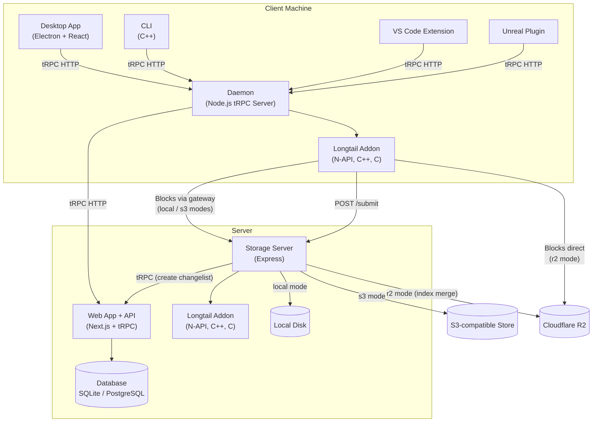
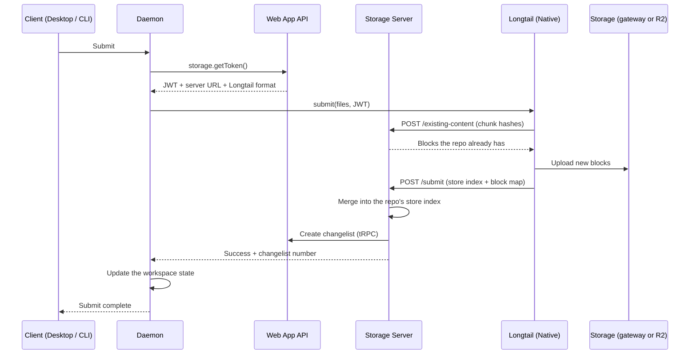
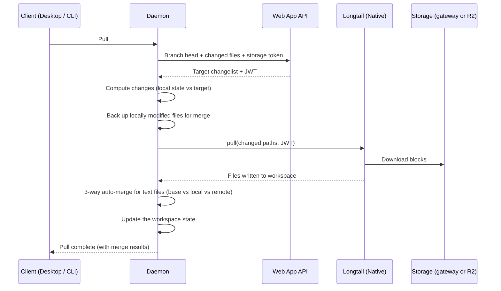

# Checkpoint VCS

Checkpoint is a version control system designed for large files and binary assets: games, film, product design, architecture, and more. It uses content-addressable chunked storage (powered by Longtail) with deduplication and compression, stored on the server's own disk, any S3-compatible object store, or Cloudflare R2. The system is composed of a web application, a local daemon, a storage server, native Longtail bindings, and client applications (desktop, CLI, VS Code, Unreal Engine, and Unreal Horde).

> [!WARNING]
> Checkpoint is in **public beta**. It is ready for small teams to self-host and use day to day, but expect bugs, and back up your server (see [Backups](https://checkpointvcs.com/docs/self-hosting/backups)). Please [report what you find](#reporting-a-bug).

**Using Checkpoint?** The user and admin documentation lives at **[checkpointvcs.com/docs](https://checkpointvcs.com/docs/)**, starting with the [Quickstart](https://checkpointvcs.com/docs/quickstart). Its source is in [`website/docusaurus/docs`](website/docusaurus/docs). This README is for people building Checkpoint from source.

## Table of Contents

- [Quickstart (Development)](#quickstart-development)
- [Architecture](#architecture)
- [Configuration](#configuration)
- [Repository Layout](#repository-layout)
- [Reporting a Bug](#reporting-a-bug)
- [License](#license)

## Quickstart (Development)

### Prerequisites

- Node.js 22 or newer (Node 20 is end-of-life; CI and the release builds use Node 24)
- Corepack (ships with Node.js)
- CMake, a C++ compiler, libcurl, and nlohmann-json (optional, for the CLI)

### Setup

```bash
git clone https://github.com/Incanta/Checkpoint.git
cd Checkpoint
corepack enable
yarn
yarn build
```

### Running the Dev Environment

Start the web app, daemon, and storage server together:

```bash
yarn dev
```

This launches the two backend services (Next.js app with API and storage server) and the client daemon service and streams their logs. The script waits for each service to report healthy before declaring the environment ready. It also generates the per-checkout secrets (storage signing key and auth secret) that a deployment has to set by hand.

To start the desktop Electron app separately (after `yarn dev` is running):

```bash
yarn desktop
```

### Building the CLI

The CLI is a standalone C++ application that talks to the daemon. It requires CMake, a C++ compiler, libcurl, and nlohmann-json.

```bash
cd src/clients/cli
mkdir -p build && cd build
cmake ..
cmake --build .
```

This produces two executables: `checkpoint` and `chk` (a short alias). Add the build directory to your `PATH` or copy the binaries somewhere convenient. Platform-specific build steps and the full command reference are in [`src/clients/cli/README.md`](src/clients/cli/README.md).

**Common commands:**

```bash
chk status              # Show pending changes
chk add file1 file2     # Stage files for submission
chk submit -m "message" # Submit staged files
chk pull                # Sync changes from remote
chk log                 # Show version history
chk branch              # List branches
chk checkout file       # Check out a controlled file for editing
chk revert file         # Revert files to the version you last synced
chk revert -a           # Revert pending files that are unchanged
chk diff file           # Show diff for a file
chk changelist new      # Create a pending changelist (alias: chk cl)
chk bug-report          # Collect a redacted log bundle
```

### Individual Services

You can also run services individually if needed:

```bash
cd src/app && yarn dev       # Next.js web app (port 13000)
cd src/core && yarn daemon   # Local daemon (port 13010)
cd src/core && yarn server   # Storage server (port 13001)
```

### Tests

```bash
yarn test
```

See [`src/tests/README.md`](src/tests/README.md) for the suites, including the native integration tests and the data-loss suite.

## Architecture

Checkpoint is a monorepo containing several interconnected components. The system follows a layered architecture where client applications talk to a local daemon, which coordinates between the web API and the storage layer.

### Components

| Component            | Path                   | Description |
| -------------------- | ---------------------- | ----------- |
| **Web App (API)**    | `src/app`              | Next.js application with a tRPC API. Manages users, organizations, repositories, branches, changelists, files, labels, merge requests, reviews, Team Sync data, and storage tokens. Uses Prisma with SQLite or PostgreSQL. Acts as the central metadata authority. |
| **Daemon**           | `src/core/daemon`      | Node.js background process running on the user's machine. Watches local workspaces for file changes, computes pending changes and sync status, and orchestrates submit and pull operations through Longtail. Exposes a tRPC HTTP API on localhost. All clients (desktop, CLI, VS Code, Unreal) talk to the daemon instead of directly to the backend services. |
| **Storage Server**   | `src/core/server`      | Express-based storage server. In `local` and `s3` modes it is also the storage gateway that clients read and write blocks through. Validates storage JWTs, answers which content a submit can reuse, merges each submit into the repo's store index, records the changelist with the app, and reports repo sizes. |
| **Common**           | `src/core/common`      | Shared TypeScript library used across daemon, server, and client code. Contains API client helpers, auth utilities, and common types. |
| **Longtail Library** | `src/longtail/library` | The core Longtail C library. Implements content-addressable chunked storage with HPCDC chunking, blake2/blake3 hashing, and zstd/lz4/brotli compression. Generally not modified. |
| **Longtail Wrapper** | `src/longtail/wrapper` | C++ wrapper around the Longtail C library. Provides higher-level functions for submit, pull, merge, and file reads, plus two storage adapters: the Checkpoint gateway (HTTP) and S3 (used for direct R2 access). |
| **Longtail Addon**   | `src/longtail/addon`   | Node.js N-API addon that bridges JavaScript to the C++ wrapper and runs Longtail operations on background threads. Published to npm as `@checkpointvcs/longtail-addon` and pinned to an exact version by its consumers. |
| **Desktop App**      | `src/clients/desktop`  | Electron application with a React UI. Manages workspaces, pending changes and pending changelists, history, branches, and Team Sync (syncing to a changelist, build steps, CI badges, and precompiled binaries). |
| **Tray**             | `src/clients/tray`     | System tray app (Go) that shows Checkpoint's status and quick actions. On Windows it also launches the daemon and restarts it if it crashes (launchd and systemd do this on macOS and Linux). |
| **CLI**              | `src/clients/cli`      | Cross-platform C++ command-line client (`checkpoint` / `chk`). Talks to the daemon over its tRPC HTTP API, and can start its own short-lived daemon for headless use such as CI. |
| **VS Code Extension**| `src/clients/vscode`   | Source control provider for Visual Studio Code. |
| **Unreal Plugin**    | `src/clients/unreal`   | Unreal Engine source control plugin that integrates Checkpoint directly into the Unreal Editor. |
| **Horde Plugin**     | `src/clients/horde`    | Version control plugin and JobDriver for Unreal Horde (commit ingestion, build scheduling, and agent workspace sync). |
| **Metrics**          | `src/metrics`          | Service that collects anonymous usage telemetry from instances that opt in (`telemetry.yaml` is off by default). |
| **Website**          | `website`              | The checkpointvcs.com landing page (Next.js) and the documentation and blog (Docusaurus). |

### System Overview



### Data Flow: Submitting a Version



### Data Flow: Pulling / Syncing



### Longtail Native Stack

The Longtail integration is structured as a three-layer stack from C up to JavaScript:

```
 JavaScript/TypeScript  (@checkpointvcs/longtail-addon)
 Async wrappers for submit, pull, merge, and file reads
            |
            v
 N-API Addon  (C++, src/longtail/addon)
 Bridges JS objects to C++ functions, manages handle lifetimes
            |
            v
 C++ Wrapper  (src/longtail/wrapper/src/)
 submit.cpp, pull.cpp, block-map.cpp, read-file.cpp: high-level operations
 Storage adapters: Checkpoint gateway (HTTP) and S3 (curl)
            |
            v
 C Library  (src/longtail/library/)
 HPCDC chunking, blake2/3 hashing, zstd/lz4/brotli compression
 Block store, version index, content index
```

## Configuration

Checkpoint uses two distinct configuration systems depending on the component. The [configuration reference](https://checkpointvcs.com/docs/self-hosting/configuration) in the docs covers each file for people running a server.

### Web App and Storage Server: YAML-based Config

The web app and storage server both use [`@incanta/config`](https://www.npmjs.com/package/@incanta/config), a YAML-based configuration library with environment-aware layering.

Each component has a `config/` directory structured as:

```
config/
  default/     # Base configuration (always loaded)
  test/        # Overrides for the test suite (merged on top of default)
  <env>/       # Any other environment you add, e.g. for a deployment
```

The active environment is selected via the `NODE_CONFIG_ENV` environment variable (e.g., `NODE_CONFIG_ENV=test`). Values from the environment-specific directory are deep-merged on top of `default/`.

Config values are accessed via dot-notation paths:

```typescript
import config from "@incanta/config";
const port = config.get<number>("server.listen-port");
const dbUrl = config.get<string>("db.url");
```

**Web App config** (`src/app/config/`):

- `auth.yaml` - Authentication settings: the session secret, who may sign up (`invite-only`), email and password accounts (with optional TOTP authenticator apps and passkeys), enterprise identity providers (Okta, Auth0, Google Workspace, Microsoft Entra ID, Keycloak, or any OpenID Connect provider), dev login toggle. Org admins can require members who sign in with a password to use a second factor; members who sign in only through an identity provider are left to that provider's MFA policy
- `db.yaml` - Database connection URL (SQLite or PostgreSQL)
- `server.yaml` - Listen port and external URL
- `storage.yaml` - Storage mode, signing key, token expiration, backend URLs, R2 account
- `longtail.yaml` - How content is chunked, hashed, and compressed (chunk and block sizes, blake3, zstd), for the whole instance. Clients get it with their storage token, and each repo keeps the values from its first use
- `state-tree.yaml` - Where state-tree blocks are stored, and their cache size
- `binary-extensions.yaml` - File extensions treated as binary (never auto-merged)
- `email.yaml` - SMTP settings for invites and notifications
- `logging.yaml` - Log level, pretty-printing, optional log file, native Longtail log level
- `secrets.yaml` - Where secret references (`secret|name`) are resolved: local file, Vault, AWS, Azure, or GCP
- `security.yaml` - Encryption key for stored integration secrets
- `updates.yaml` - Update checks, channel, and notification emails
- `telemetry.yaml`, `newsletter.yaml`, `stripe.yaml` - Anonymous usage reporting, the newsletter signup, and billing (all off by default)
- `environment.yaml` (beside `default/`) - Exports config values to the environment of the app's processes (e.g., `db.url` as `DATABASE_URL`), for code and tools that read env vars, such as Prisma

**Storage Server config** (`src/core/server/config/`):

- `server.yaml` - Listen port
- `storage.yaml` - Storage mode (`local`, `s3`, or `r2`), the local data directory or S3/R2 settings, the signing key shared with the app, and the dedup index settings
- `checkpoint.yaml` - Web app API URL for callbacks
- `logging.yaml` - Log level, pretty-printing, optional log file, native Longtail log level
- `secrets.yaml` - Where secret references are resolved, as for the app

**Storage modes.** `local` keeps blocks on the storage server's own disk; `s3` keeps them in one bucket on any S3-compatible store (MinIO, SeaweedFS's S3 gateway, AWS, DigitalOcean Spaces). In both, clients read and write through the storage server's gateway. `r2` uses Cloudflare R2, which clients access directly. The `mode` must match in the app's and the storage server's `storage.yaml`.

**Storage signing key (required).** The web app signs storage tokens and the storage server verifies them with a shared HS256 key, `storage.jwt.signing-key`. It has no default, and both processes refuse to start unless it is a random value of at least 32 characters, because anyone who knows it can mint a write token for any repo. Generate one with `openssl rand -hex 32` and set the same value on both, either in each `storage.yaml` or with the `CHECKPOINT_STORAGE_SIGNING_KEY` environment variable (which takes precedence). `yarn dev` generates a per-checkout key for local development, so this only needs doing for a deployment or when starting the services by hand.

**Auth secret (required).** The web app signs session cookies with `auth.secret`, so anyone who knows it can sign in as anyone. It works the same way: no default, and the app refuses to start unless it is a random value of at least 32 characters. Set it in `auth.yaml` (a secret reference such as `secret|betterauth_secret` works, as the Docker Compose config does) or with `CHECKPOINT_AUTH_SECRET`, which takes precedence. `yarn dev` generates one per checkout. Unless `security.encryption-key` is set, stored integration secrets (issue tracker tokens) are encrypted with a key derived from it, so changing it means re-entering those.

### Daemon: JSON-based Config

The daemon uses its own JSON configuration system with multiple layers.

#### Global Daemon Config

**Location:** `~/.checkpoint/daemon.json`

Created automatically on first run. Controls global daemon behavior. Abridged:

```json
{
  "daemonPort": 13010,
  "mcp": { "enabled": false, "port": 13011 },
  "workspaces": [],
  "updates": { "channel": "release" },
  "logging": {
    "level": "info",
    "prettify": { ... },
    "logFile": {
      "level": "info",
      "path": "logs/daemon.log",
      "maxArchivedFiles": 10,
      "maxFileSizeMB": 20
    }
  }
}
```

The `workspaces` array tracks all registered local workspaces. The daemon reads and writes this file through the `DaemonConfig` singleton. `mcp` turns on an opt-in Model Context Protocol server that exposes the daemon API on its own port.

#### Auth Config

**Location:** `~/.checkpoint/auth.json`

Stores authentication tokens per daemon instance. Managed by the common library's auth utilities.

#### Per-Workspace Files

Each workspace tracked by Checkpoint has a `.checkpoint/` directory at its root. Nothing under it can be submitted. The daemon manages these files; don't edit them by hand.

- `workspace.json` - Workspace identity: its id, repo, name, and branch.
- `state.db` - The current changelist and the inventory of tracked files with their hashes, sizes, and modification times (a SQLite database; a workspace still on the older `state.json` is imported on first open).
- `pending-changelists.json` and `staged-blobs/` - Pending changelists and the staged content of their files.
- `pull-backups/` and `clean-backups/` - Copies of local files that a pull or Clean Workspace moved aside.

## Repository Layout

| Path | What's there |
| --- | --- |
| `src/` | All application code (see [Components](#components)) |
| `website/` | Landing page and Docusaurus docs |
| `docker-compose/` | The self-hosting Docker Compose bundle and its [README](docker-compose/README.md) |
| `docker/` | The version-independent runtime image that downloads and runs Checkpoint server bundles |
| `installer/` | Desktop and CLI installer packaging |
| `scripts/` | Build, packaging, release, and CI helper scripts |
| `benchmark/` | Benchmarks against other version control systems |
| `plans/` | Design and implementation plans for larger changes |
| `.github/` | CI workflows and [release documentation](.github/RELEASING.md) |

## Reporting a Bug

Attach a log bundle to your bug report on [GitHub Issues](https://github.com/Incanta/Checkpoint/issues). It is a zip of the daemon's logs, the desktop app's logs, version information, your redacted `daemon.json`, and a summary of each workspace (its changelist, whether a pull was interrupted, counts of tracked and pending files, and recent pull and submit errors). It never contains `~/.checkpoint/auth.json`, any token, or the contents of your files.

- **Desktop app:** Settings, Troubleshooting, **Collect logs**. On macOS it is also under Help, **Collect Logs for a Bug Report**. The folder holding the zip opens when it is ready.
- **CLI:** `chk bug-report` prints the path of the zip.

Bundles are written to `~/.checkpoint/bug-reports/` (the newest 10 are kept). Tokens, passwords, keys, cookies, email addresses (each replaced with a stable placeholder such as `[email-1]`), and the username in home-directory paths are redacted. Repo and workspace-relative paths are kept, since they are needed to debug; `README.txt` inside the zip lists exactly what is redacted and kept. Look the bundle over before you share it.

The daemon always writes its log to `~/.checkpoint/logs/daemon.log` at `info` level. Each start archives the previous log, a log larger than `logging.logFile.maxFileSizeMB` (20 MB) is archived too, and `maxArchivedFiles` (10) archives are kept. Daemons the CLI starts on its own (headless mode) log to `ephemeral-daemon.log` beside it, and the CLI captures their console output to `ephemeral.log` (in the workspace's `.checkpoint/` folder, or `~/.checkpoint/` outside a workspace), which is the file to check when the CLI reports it timed out starting the daemon. On Windows the tray also captures the daemon's console output (warnings, errors, and native crash output) to `daemon-process.log`, archiving it on each launch and keeping 10 archives.

For a self-hosted server's app and storage server logs, see [Collecting server logs for a bug report](docker-compose/README.md#7-collecting-server-logs-for-a-bug-report).

## License

Checkpoint is dual-licensed under the [Elastic License 2.0](./LICENSE.elastic) or [AGPLv3](./LICENSE.agpl). This means you can choose which license you want to operate under.

### Which license is best for me?

⚠️ **This is not legal advice; please seek your own legal counsel.** ⚠️

**For most people,** if you're only hosting/using Checkpoint for your own company/entity, and/or its subsidiaries, the [Elastic License 2.0](./LICENSE.elastic) should be more favorable for you. While it's not an official OSI license, it's very permissive with its [main limitation being "You may not provide the software to third parties as a hosted or managed service..."](./LICENSE.elastic#limitations).

If you want to "provide the software to third parties as a hosted or managed service", you must use the [AGPLv3](./LICENSE.agpl) license which is an [OSI-approved license](https://opensource.org/license/agpl-v3). This license has more limitations and conditions, which you should read in full **and** seek legal counsel for.
